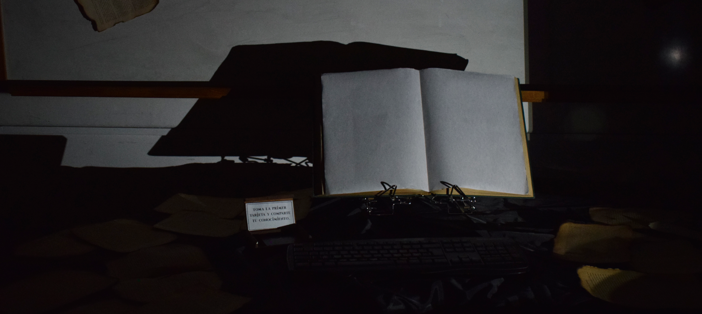
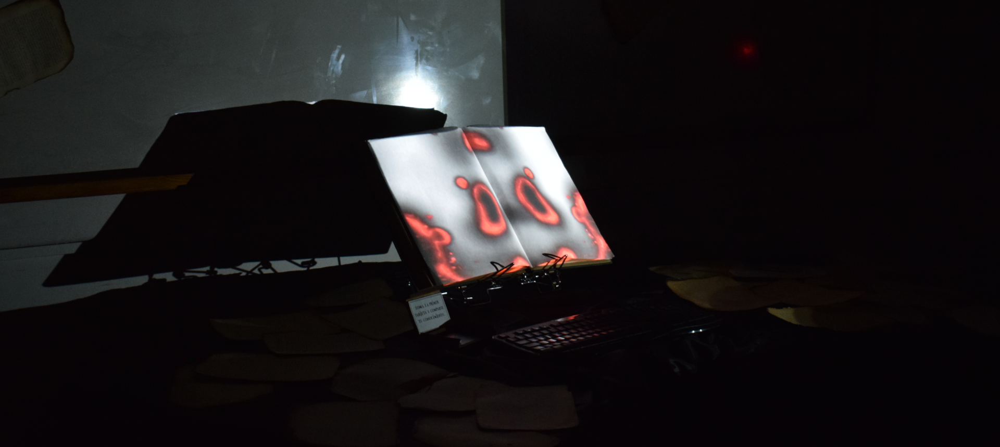
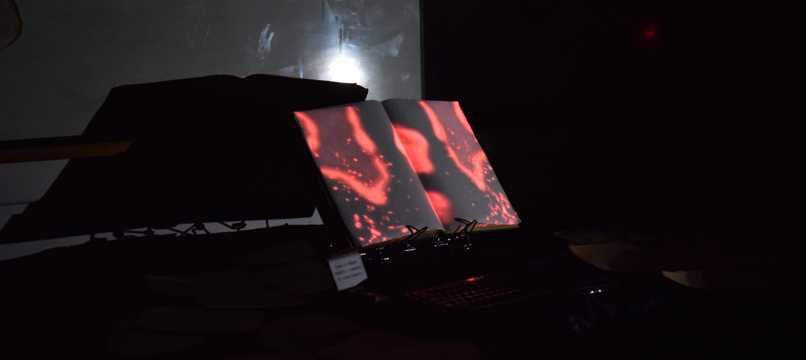
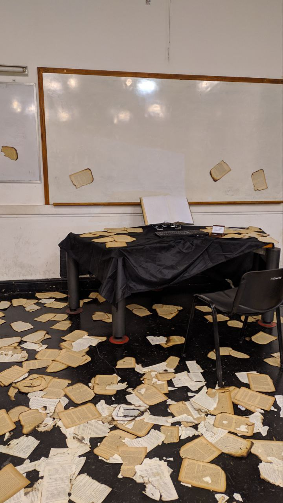
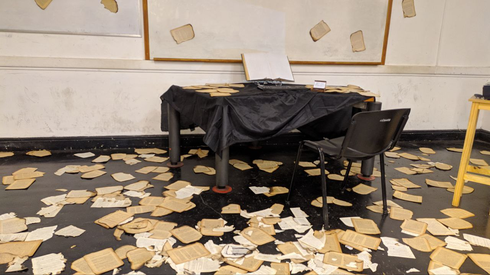
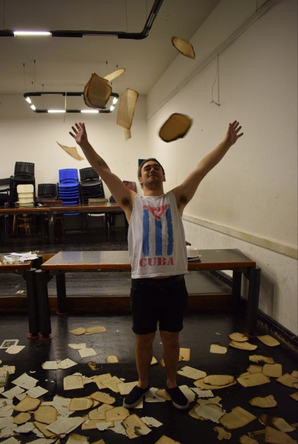

# The Library — gallery

Photographic record of the installation as it was shown: the projection on the book and people using it, followed by the setup of the room and, to close, throwing the burnt pages.

## Banners

`TheLibrary_Banner_EN.png` — Logo banner, English

`TheLibrary_Banner_ES.png` — Logo banner, Spanish (original)

## Photos

### The book waiting for the next user

`TheLibrary_01_Book.png`

### A user writing on the projected pages

`TheLibrary_02_Writing.png`

### The book burning

`TheLibrary_03_Burning.png`

### The book burning

`TheLibrary_04_Burning.png`

### Setup: the table with the book, lights on

`TheLibrary_06_Table.jpg`

### Setup: the table with the book, front view

`TheLibrary_07_Table.jpg`

### Setup: the room with the computer

`TheLibrary_08_Room.jpg`

### Setup: the room, wide view

`TheLibrary_09_Room.jpg`

### Setup: the projector on the floor facing the book

`TheLibrary_10_Projector.jpg`

### Setup: the projector and the room from the corner

`TheLibrary_11_Projector.jpg`

### Setup: throwing the burnt pages around the room

`TheLibrary_05_ThrowingPages.jpg`
