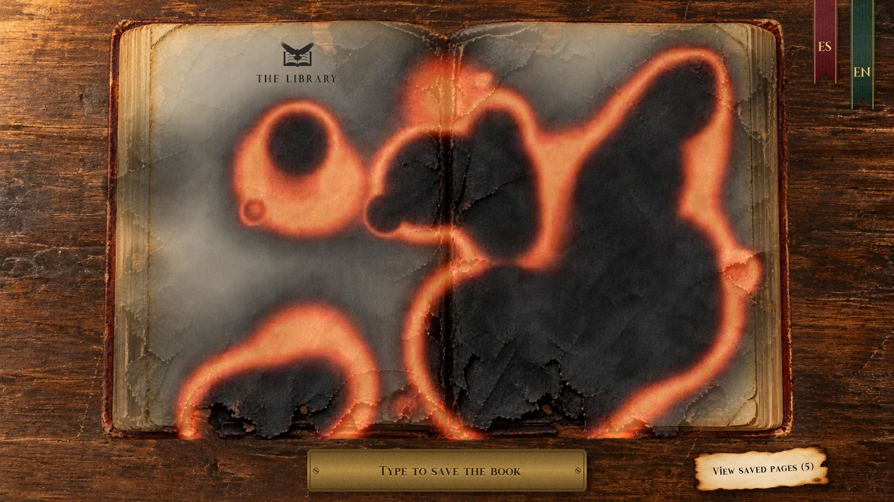
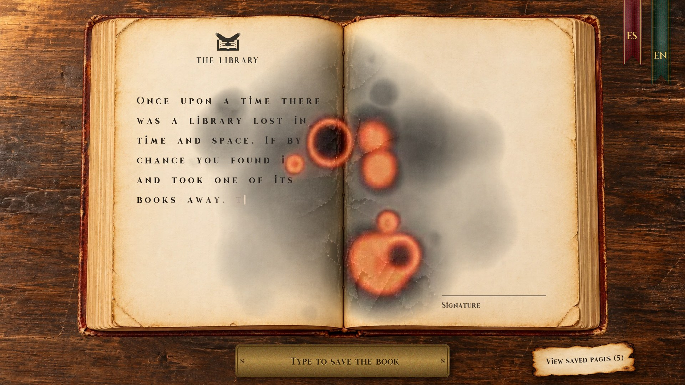
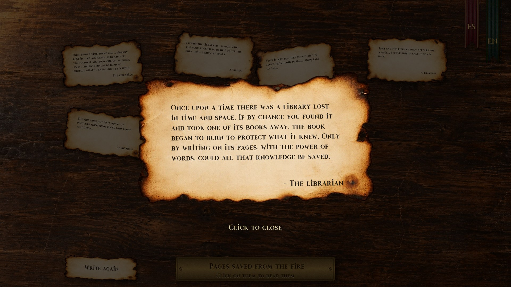
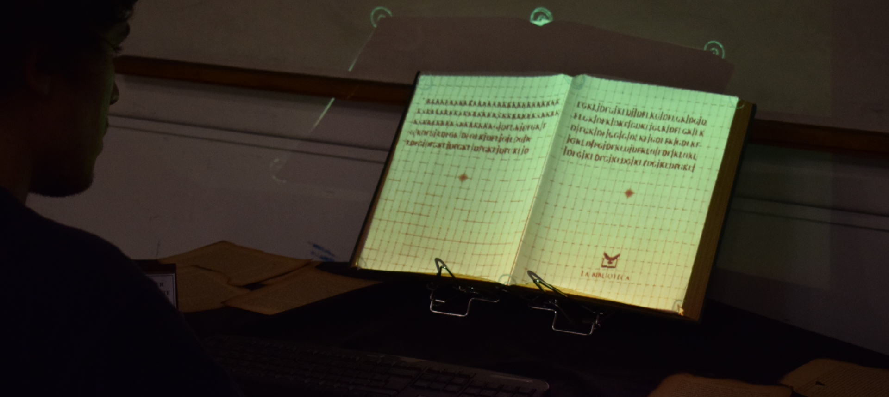
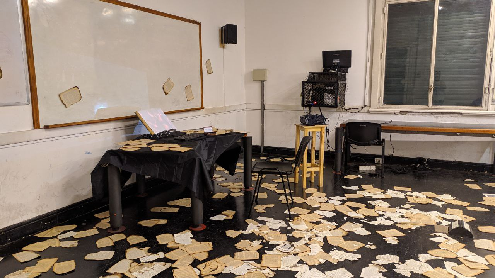
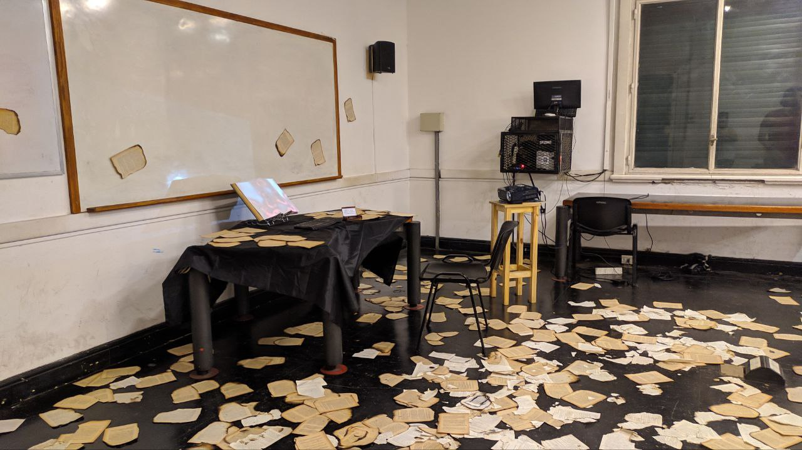
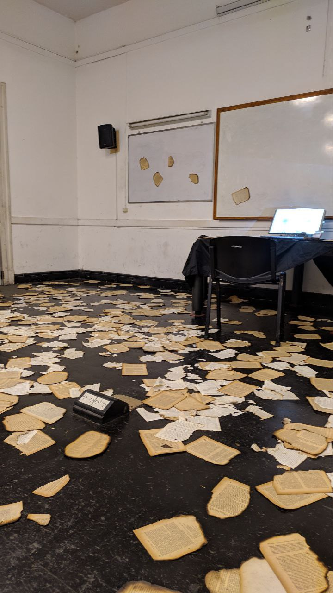
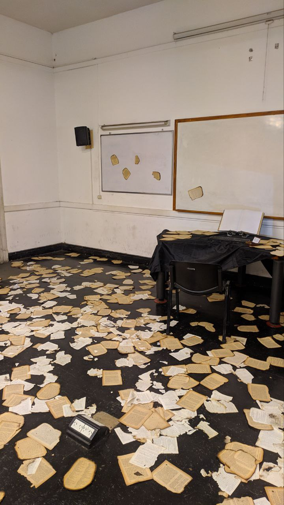

# The Library — gallery

Screenshots of the browser version, followed by the photographic record of the installation as it was shown: the projection on the book and people using it, followed by the setup of the room and, to close, throwing the burnt pages. The image was projected from the classroom's ceiling projector.

## Banners

`TheLibrary_Banner_EN.png` — Logo banner, English

`TheLibrary_Banner_ES.png` — Logo banner, Spanish (original)

## Browser version

Screenshots of the p5.js version, in English and Spanish (`_EN` / `_ES`).

### The book burning, waiting for someone to write

`TheLibrary_Web_01_Burning_EN.jpg` · `TheLibrary_Web_01_Burning_ES.jpg`

### Writing pushes the fire back

`TheLibrary_Web_02_Writing_EN.jpg` · `TheLibrary_Web_02_Writing_ES.jpg`

### The book is safe: signing the page

`TheLibrary_Web_03_Sign_EN.jpg` · `TheLibrary_Web_03_Sign_ES.jpg`

### The table with the pages saved from the fire

`TheLibrary_Web_04_Library_EN.jpg` · `TheLibrary_Web_04_Library_ES.jpg`

### Reading a saved page

`TheLibrary_Web_05_Reading_EN.jpg` · `TheLibrary_Web_05_Reading_ES.jpg`

## Installation photos

### The book waiting for the next user

`TheLibrary_01_Book.png`

### A user writing on the projected pages

`TheLibrary_02_Writing.png`

### The book burning

`TheLibrary_03_Burning.png`

### The book burning

`TheLibrary_04_Burning.png`

### Setup: the table with the book, lights on

`TheLibrary_06_Table.jpg`

### Setup: the table with the book, front view

`TheLibrary_07_Table.jpg`

### Setup: the room with the computer

`TheLibrary_08_Room.jpg`

### Setup: the room, wide view

`TheLibrary_09_Room.jpg`

### Setup: the room from the back corner

`TheLibrary_10_Projector.jpg`

### Setup: the table and the whiteboard from the back corner

`TheLibrary_11_Projector.jpg`

### Setup: throwing the burnt pages around the room

`TheLibrary_05_ThrowingPages.jpg`
