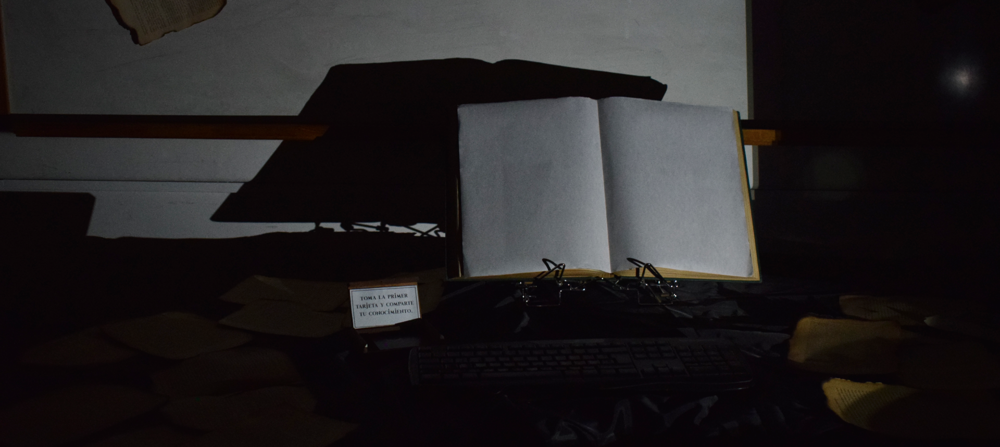
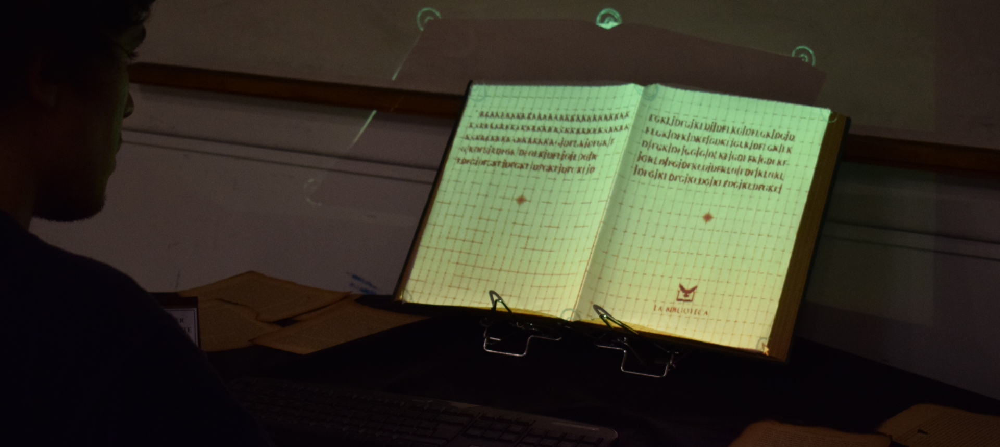
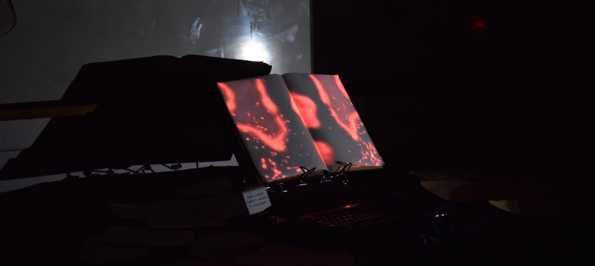

*This readme is written in SPANISH. If you prefer, you can read this in [English](README.md).*

# La Biblioteca

Proyección Mapping de un Sistema de escritura. Hecho en Processing, Java.

## Estructura del repositorio

- [`TheLibrary_Processing`](TheLibrary_Processing) — sketch original de la instalación (Processing 3.5.4), con sus videos y logo en `data/`.
- [`TheLibrary_p5js`](TheLibrary_p5js) — versión para navegador en p5.js (en desarrollo), con la misma lógica que la original: dos páginas como un libro abierto, sin mapping.
- [`Gallery`](Gallery) — registro fotográfico de la muestra, incluidas las fotos de abajo.

## Tecnologías

Desarrollado utilizando:
- Lenguaje Java
- Processing 3.5.4
- Librería de mapping Keystone (David Bouchard)
- Librería de Video para Processing 3 (The Processing Foundation)

## Cómo correr la versión de Processing

1. Instalar [Processing](https://processing.org/download) (probado con 4.5; hecho originalmente con 3.5.4).
2. Instalar **Video Library for Processing 4** (The Processing Foundation) desde *Sketch → Importar biblioteca → Gestionar bibliotecas…*.
3. Instalar **Keystone** (David Bouchard) a mano: descargarla de [keystonep5.sourceforge.net](https://keystonep5.sourceforge.net/) y descomprimir la carpeta `keystone` en `Documentos/Processing/libraries`.
4. Opcional: descargar la tipografía [The Queen](https://fontbundles.net/free-fonts/the-queen) y poner `TheQueen.ttf` en `TheLibrary_Processing/data/`. Sin ella se usa Georgia.
5. Abrir `TheLibrary_Processing/TheLibrary_Processing.pde` y apretar Run.

Teclas de calibración de la proyección: `*` activa/desactiva la calibración, `+` la guarda en `keystone.xml`, `-` la carga.

## Idea y desarrollo

Esta experiencia interactiva está diseñada para su uso individual en varias iteraciones.
Cada usuario que interactúa tipea sobre un teclado y recibe feedback visual sobre la superficie mapeada de un libro.
El libro simula estar quemándose y la interacción del usuario le permite revertirlo.
Al finalizar, el sistema hace una copia de lo escrito y se reinicia para recibir al próximo usuario.

## Implementación

Se implementó la Librería de mapping para realizar una proyección sobre la superficie de un libro.
Los usuarios reciben feedback visual de su interacción como si de una pantalla se tratase.

Se implementó la Librería de video para reproducir en la superficie del libro un video de llamas que simulan que la superficie se está quemando.
El video avanza o retrocede su reproducción dependiendo de la interacción del usuario.

## Galería de imágenes

## Créditos y links

Los videos e imágenes utilizados fueron proporcionados por colaboradores encargados de otras áreas de realización del proyecto.
- La tipografía utilizada es [“The Queen”](https://fontbundles.net/free-fonts/the-queen) de Font Bundles, gratuita para uso personal y comercial. Su licencia no permite compartir el archivo de la fuente, por eso no está incluida en este repositorio.

## Cambios realizados

- Se agregaron comentarios y pestañas.  
- Se mejoraron los nombres de variables y su jerarquía.
