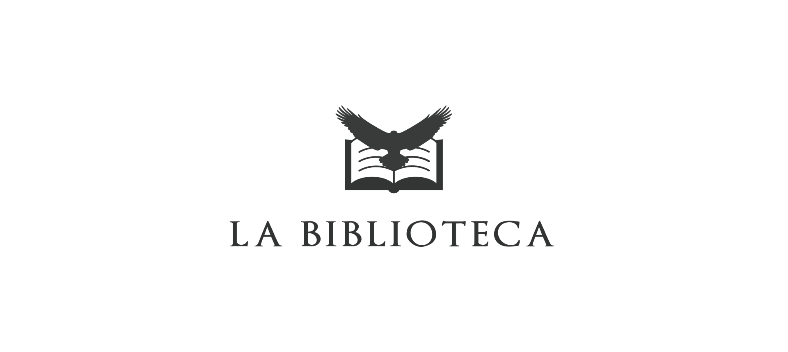
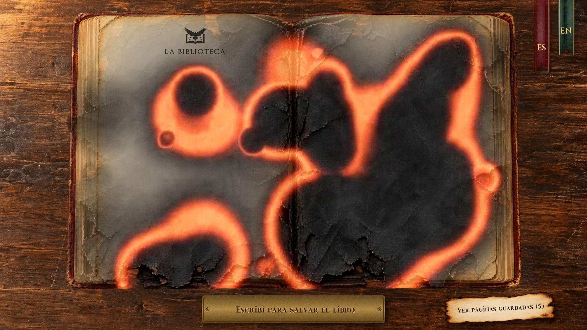
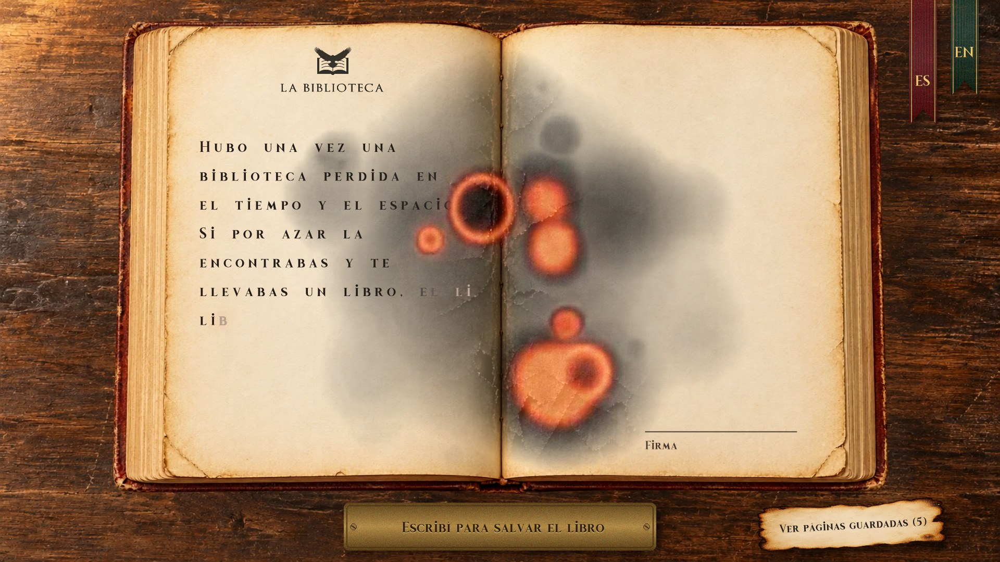
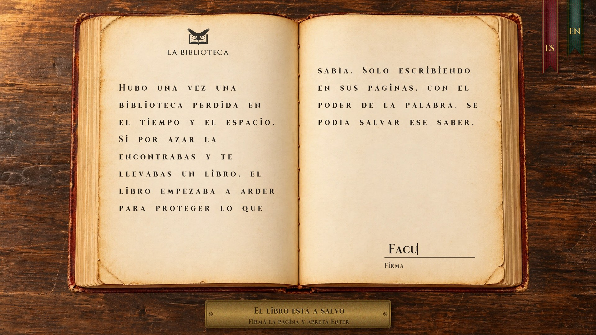
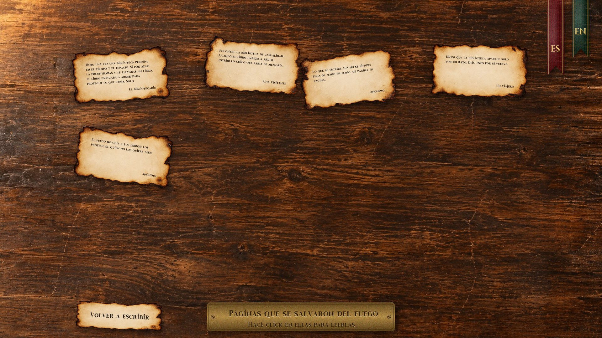
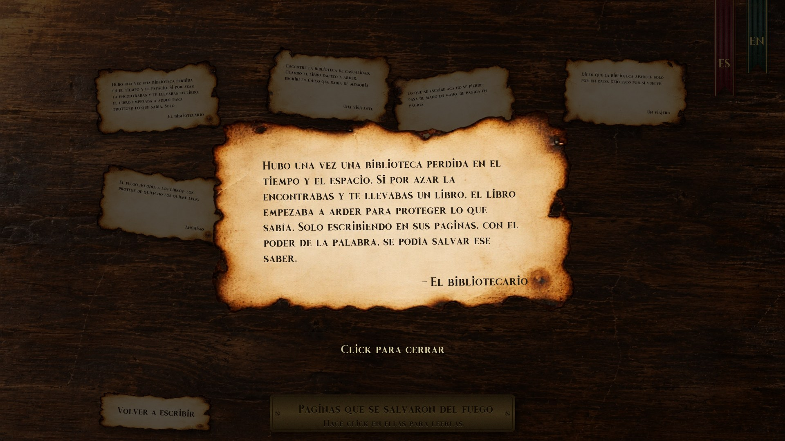
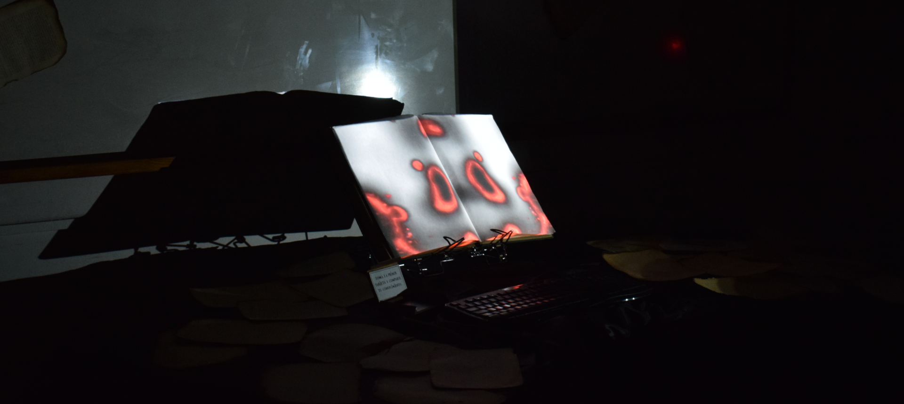
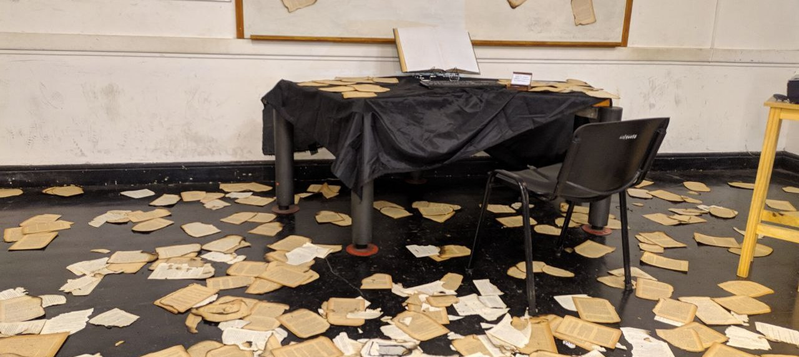

*This readme is written in SPANISH. If you prefer, you can read this in [English](README.md).*

# La Biblioteca

Un libro se está quemando y solo escribiendo se lo puede salvar. Una pieza interactiva de escritura que se juega en el navegador, hecha en p5.js (JavaScript).

Originalmente fue una instalación interactiva de proyección mapping, hecha en Processing (Java).

## Estructura del repositorio

- [`TheLibrary_p5js`](TheLibrary_p5js) — versión para navegador en p5.js, con la misma lógica que la instalación: dos páginas como un libro abierto, sin mapping. Su README explica cómo jugarla y correrla.
- [`TheLibrary_Processing`](TheLibrary_Processing) — sketch original de la instalación en Processing, con sus videos y logo en `data/`.
- [`Gallery`](Gallery) — registro fotográfico de la muestra.

## Idea y desarrollo

Esta experiencia interactiva está diseñada para su uso individual en varias iteraciones.
Cada usuario tipea sobre un teclado y ve aparecer el texto en las páginas de un libro.
El libro simula estar quemándose y la interacción del usuario le permite revertirlo.
Al finalizar, el sistema guarda una copia de lo escrito y se reinicia para recibir al próximo usuario.

En la instalación, la imagen se proyectaba sobre un libro real, sin contexto: la gente entraba a una sala oscura y encontraba el libro ya quemándose.

## Implementación

**Versión para navegador.** El fuego es una secuencia de 271 cuadros guardada en dos hojas de imágenes: una máscara que quema el libro y el brillo de las brasas. Cada carácter escrito hace retroceder el fuego en proporción a los caracteres que faltan, así el fuego llega al inicio justo cuando se alcanza el objetivo. Las páginas salvadas se firman y quedan sobre una mesa, guardadas solo en el navegador de quien juega.

**Instalación original.** Se implementó la librería de mapping para realizar una proyección sobre la superficie de un libro, así los usuarios recibían feedback visual de su interacción como si de una pantalla se tratase. La librería de video reproducía sobre el libro un video de llamas que avanzaba o retrocedía según la interacción del usuario.

## Tecnologías

Versión para navegador:
- JavaScript
- p5.js 1.11
- Web Audio API

Instalación original:
- Lenguaje Java
- Processing 4.5 (hecho originalmente con 3.5.4)
- Librería de mapping Keystone (David Bouchard)
- Librería de Video para Processing 4 (originalmente la versión para Processing 3, The Processing Foundation)

## Galería de imágenes

### Versión para navegador

### Instalación original

Más fotos en la [galería](Gallery).

## Créditos y links

Los videos e imágenes utilizados fueron proporcionados por colaboradores encargados de otras áreas de realización del proyecto.
- La tipografía utilizada es [“The Queen”](https://fontbundles.net/free-fonts/regular-fonts/the-queen) de Font Bundles, con su licencia Premium. La licencia permite usarla como web font pero no compartir el archivo de la fuente, por eso no está incluida en este repositorio.

## Cambios realizados

- Se agregó una versión para navegador en p5.js.
- Se agregaron comentarios y pestañas.
- Se mejoraron los nombres de variables y su jerarquía.
