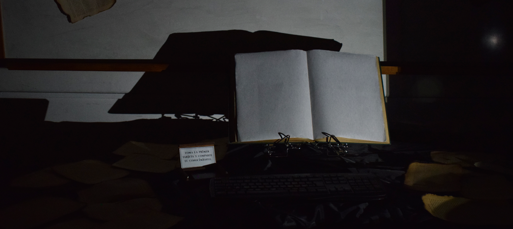
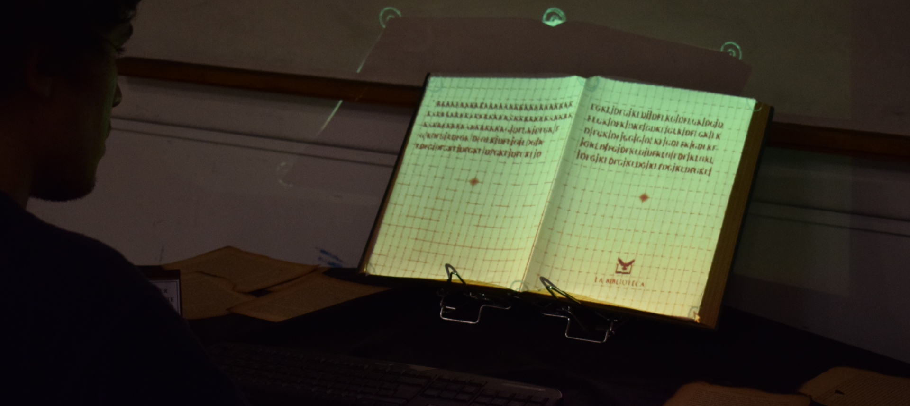
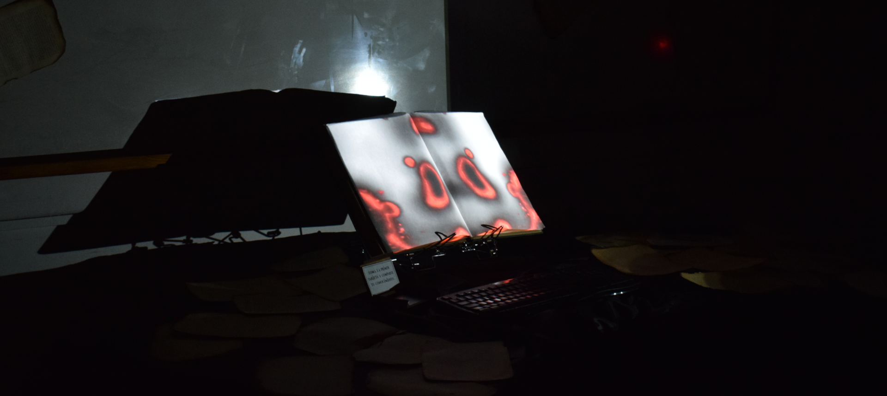
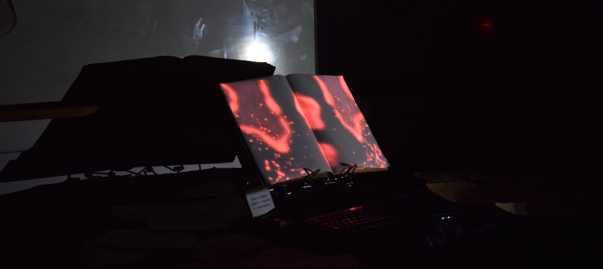

*Este readme está escrito en INGLÉS. Si lo prefieres, puedes leerlo en [español](README.es.md).*

# The Library

Mapping projection of a writing input system. Made with Processing, Java.

## Repository structure

- [`TheLibrary_Processing`](TheLibrary_Processing) — original installation sketch (Processing 3.5.4), with its videos and logo in `data/`.
- [`TheLibrary_p5js`](TheLibrary_p5js) — browser version in p5.js (work in progress), with the same logic as the original: two pages like an open book, without mapping.
- [`Gallery`](Gallery) — photographic record of the exhibition, including the photos shown below.

## Technologies

Developed using:
- Java Language
- Processing 3.5.4
- Keystone Mapping Library (David Bouchard)
- Video Library for Processing 3 (The Processing Foundation)

## How to run the Processing version

1. Install [Processing](https://processing.org/download) (tested with 4.5; originally made with 3.5.4).
2. Install **Video Library for Processing 4** (The Processing Foundation) from *Sketch → Import Library → Manage Libraries…*.
3. Install **Keystone** (David Bouchard) manually: download it from [keystonep5.sourceforge.net](https://keystonep5.sourceforge.net/) and unzip the `keystone` folder into `Documents/Processing/libraries`.
4. Optional: download the font [The Queen](https://fontbundles.net/free-fonts/the-queen) and put `TheQueen.ttf` in `TheLibrary_Processing/data/`. Without it, Georgia is used.
5. Open `TheLibrary_Processing/TheLibrary_Processing.pde` and press Run.

Projection calibration keys: `*` toggles calibration, `+` saves it to `keystone.xml`, `-` loads it.

## Idea and development

This interactive experience is designed for individual use in multiple iterations. 
Each interacting user types on a keyboard and receives visual feedback on the mapped surface of a book. 
The book simulates to be burning and the user interaction allows you to reverse it.
At the end, the system makes a copy of what was written and restarts to receive the next user.

## Implementation

The mapping library was implemented to perform a projection on the surface of a book.
Users receive visual feedback from their interaction on the book as if it were a screen.

The Video Library has been implemented to play a video of flames on the surface of the book, simulating that the surface is burning.
The video advances or rewinds its playback depending on the user's interaction.

## Image gallery

## Links and credits

The videos and images used were provided by collaborators in charge of other areas of the project.
- The font used is ["The Queen"](https://fontbundles.net/free-fonts/the-queen) by Font Bundles, free for personal and commercial use. Its license does not allow sharing the font file, so it is not included in this repository.

## Change log

- Added comments and tabs. 
- Improved variable naming and hierarchy.
