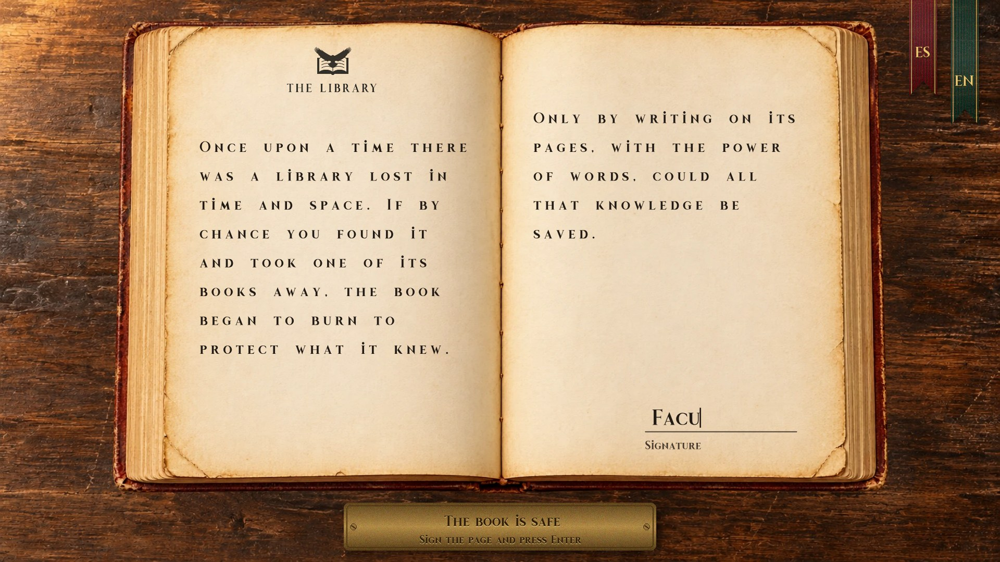
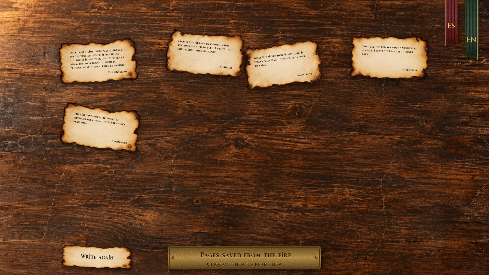
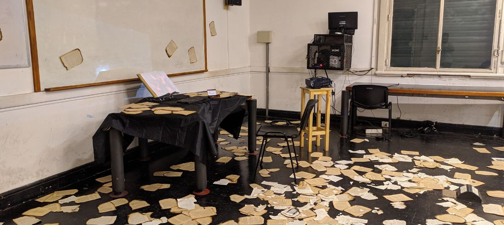

*Este readme está escrito en INGLÉS. Si lo prefieres, puedes leerlo en [español](README.es.md).*

# The Library

A book is burning, and only writing can save it. An interactive writing piece playable in the browser, made with p5.js (JavaScript).

It was originally an interactive projection mapping installation, made with Processing (Java).

## Repository structure

- [`TheLibrary_p5js`](TheLibrary_p5js) — browser version in p5.js, with the same logic as the installation: two pages like an open book, without mapping. Its README explains how to play and run it.
- [`TheLibrary_Processing`](TheLibrary_Processing) — original installation sketch in Processing, with its videos and logo in `data/`.
- [`Gallery`](Gallery) — photographic record of the exhibition.

## Idea and development

This interactive experience is designed for individual use in multiple iterations.
Each user types on a keyboard and sees the text appear on the pages of a book.
The book simulates to be burning and the user interaction allows you to reverse it.
At the end, the system keeps a copy of what was written and restarts to receive the next user.

In the installation, the image was projected onto a real book, with no context: people walked into a dark room and found the book already burning.

## Implementation

**Browser version.** The fire is a sequence of 271 frames stored in two image sheets: a mask that burns the book and the glow of the embers. Every character typed rewinds the fire, in proportion to the characters still needed, so the fire reaches the start just as the goal is met. Saved pages are signed and kept on a table, only in the player's browser.

**Original installation.** The mapping library was implemented to perform a projection on the surface of a book, so users received visual feedback from their interaction on the book as if it were a screen. The video library played a video of flames on the surface of the book, which advanced or rewound depending on the user's interaction.

## Technologies

Browser version:
- JavaScript
- p5.js 1.11
- Web Audio API

Original installation:
- Java
- Processing 4.5 (originally made with 3.5.4)
- Keystone Mapping Library (David Bouchard)
- Video Library for Processing 4 (originally the Processing 3 version, The Processing Foundation)

## Image gallery

### Browser version

### Original installation

More photos in the [gallery](Gallery).

## Links and credits

The videos and images used were provided by collaborators in charge of other areas of the project.
- The font used is ["The Queen"](https://fontbundles.net/free-fonts/regular-fonts/the-queen) by Font Bundles, under its Premium License. The license allows using it as a web font but not sharing the font file, so it is not included in this repository.

## Change log

- Added a browser version in p5.js.
- Added comments and tabs.
- Improved variable naming and hierarchy.
